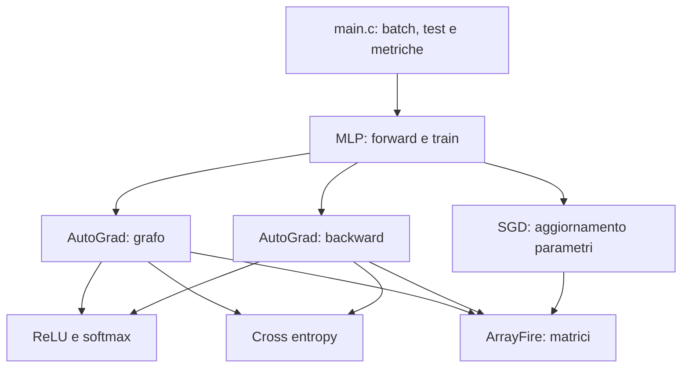
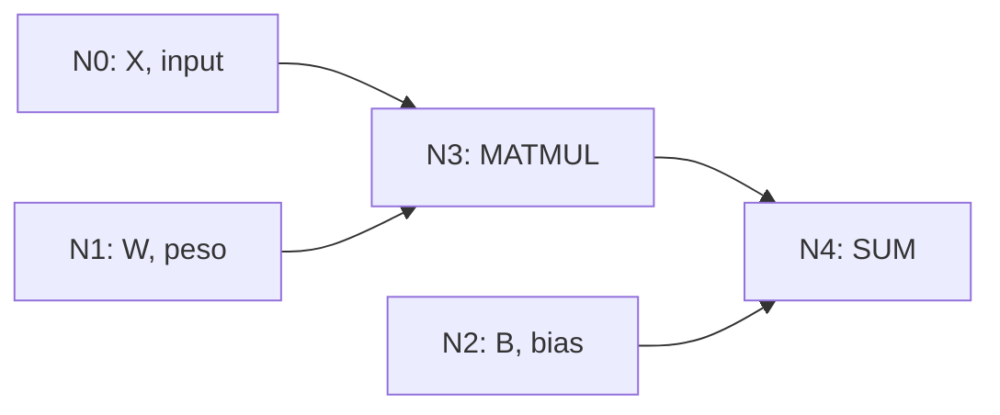
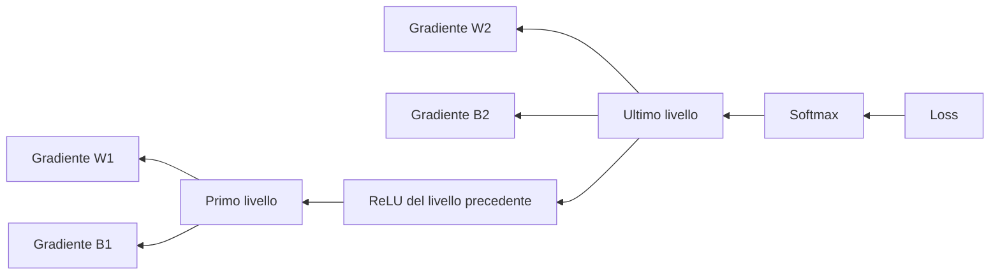
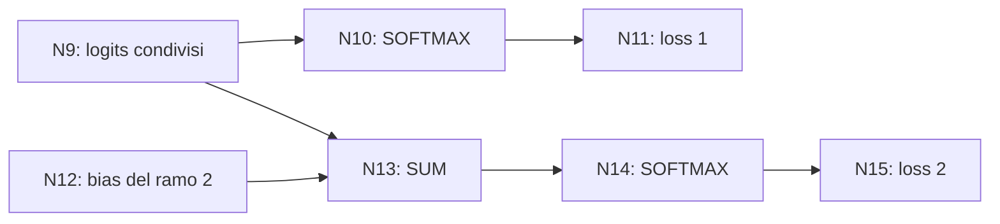
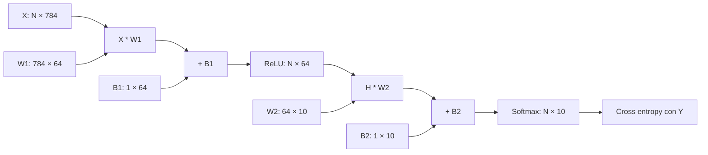
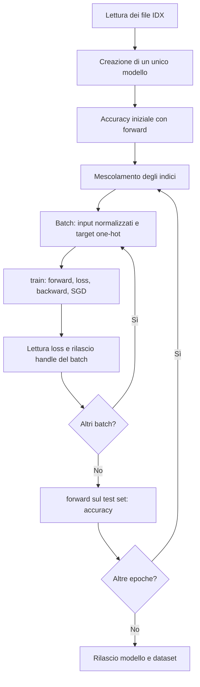

# DeepLearning_FrameWork

## Indice

- [Setup ed esecuzione](#setup-ed-esecuzione)
- [Panoramica e struttura](#panoramica-e-struttura)
- [Matrici e convenzioni](#matrici-e-convenzioni)
- [Modulo general](#modulo-general)
- [Modulo AutoGrad: grafo](#modulo-autograd-grafo)
- [Modulo AutoGrad: backpropagation](#modulo-autograd-backpropagation)
- [Modulo activation_functions](#modulo-activation_functions)
- [Modulo loss](#modulo-loss)
- [Modulo optimizers](#modulo-optimizers)
- [Modulo models/MLP](#modulo-modelsmlp)
- [Modulo main: test e MNIST](#modulo-main-test-e-mnist)
- [Modulo setup: Makefile e scripts](#modulo-setup-makefile-e-scripts)
- [Memoria e limiti attuali](#memoria-e-limiti-attuali)

## Setup ed esecuzione

Esegui i comandi dalla cartella principale del progetto. Il programma usa C17 e il backend **CPU** di ArrayFire, collegato con `-lafcpu`.

Servono GCC a 64 bit, GNU Make e ArrayFire. Per scaricare ArrayFire con gli script serve anche `curl`. Gli script scaricano gli installer ufficiali **3.10.0 per x64** in `deps/downloads`; l'installazione va eseguita separatamente.

### Windows

1. Installa GCC a 64 bit, ad esempio tramite MSYS2 UCRT64, e GNU Make. Rendi disponibili `gcc` e `make` nel `PATH`.
2. Scarica ArrayFire:

   ```powershell
   make setup-windows
   ```

3. Avvia l'installer scaricato:

   ```powershell
   & ".\deps\downloads\ArrayFire-v3.10.0-Windows-x64.exe"
   ```

4. Installa ArrayFire e riapri il terminale. Il percorso standard è `C:/Program Files/ArrayFire/v3`. Se le DLL non vengono trovate, configura il terminale corrente:

   ```powershell
   $env:AF_PATH = "C:\Program Files\ArrayFire\v3"
   $env:Path = "$env:AF_PATH\lib;$env:Path"
   ```

5. Compila e avvia:

   ```powershell
   make build
   .\frame_work
   ```

La cartella `lib` contiene le DLL di ArrayFire e delle sue dipendenze. [Documentazione Windows di ArrayFire](https://arrayfire.org/docs/using_on_windows.htm).

### Linux

Su Debian/Ubuntu puoi installare gli strumenti di compilazione e download con:

```bash
sudo apt update
sudo apt install build-essential curl
```

Scarica e installa ArrayFire:

```bash
make setup-linux
sudo bash deps/downloads/ArrayFire-v3.10.0-Linux-x64.sh --include-subdir --prefix=/opt
```

L'installazione così configurata usa `/opt/arrayfire`, il percorso predefinito del Makefile. Compila e avvia:

```bash
make build
./frame_work
```

Su Linux il Makefile incorpora nell'eseguibile un `RPATH` assoluto verso `AF_LIB_DIR`, usato anche per le dipendenze indirette nella stessa cartella. Non serve impostare `LD_LIBRARY_PATH` per quella cartella. Se hai già compilato il programma con il vecchio Makefile, esegui `make rebuild` per aggiornare l'eseguibile.

Per eventuali dipendenze di sistema aggiuntive, consulta le [istruzioni di installazione ArrayFire](https://arrayfire.org/docs/installing.htm).

### Configurare AF_DIR

`AF_DIR` indica la cartella di installazione, che contiene `include` e `lib` oppure `lib64`. Il Makefile sceglie il percorso in questo ordine:

1. `AF_DIR` passato a `make`.
2. `AF_DIR` definito nell'ambiente.
3. `AF_PATH` definito nell'ambiente.
4. Il percorso standard: `C:/Program Files/ArrayFire/v3` su Windows, `/opt/arrayfire` su Linux.

Esempi di percorsi personalizzati:

```bash
make build AF_DIR="D:/Librerie/ArrayFire"
make build AF_DIR="/home/mario/arrayfire"
```

`AF_LIB_DIR` individua automaticamente `lib64` quando contiene `libafcpu.so`, altrimenti usa `lib`. Puoi impostarla esplicitamente:

```bash
make build AF_DIR="/home/mario/arrayfire" AF_LIB_DIR="/home/mario/arrayfire/lib64"
```

Su Windows le DLL devono essere raggiungibili anche tramite `PATH`. Su Linux `AF_LIB_DIR` viene incorporata nell'eseguibile come percorso di ricerca delle librerie a runtime; se sposti l'installazione di ArrayFire, ricompila con `make rebuild AF_DIR="/nuovo/percorso/arrayfire"` (e aggiorna `AF_LIB_DIR` se l'avevi impostata esplicitamente).

### Dataset MNIST

Il repository contiene i file MNIST nella cartella `data/mnist`. Il main legge questi quattro file **IDX non compressi**:

```text
data/mnist/
├── train-images-idx3-ubyte
├── train-labels-idx1-ubyte
├── t10k-images-idx3-ubyte
└── t10k-labels-idx1-ubyte
```

Se hai soltanto i file `.gz`, estraili mantenendo esattamente questi nomi. Il main non scarica né decomprime il dataset. I file originali sono disponibili nel mirror usato da [Torchvision per MNIST](https://github.com/pytorch/vision/blob/main/torchvision/datasets/mnist.py):

- [Immagini di training](https://ossci-datasets.s3.amazonaws.com/mnist/train-images-idx3-ubyte.gz)
- [Etichette di training](https://ossci-datasets.s3.amazonaws.com/mnist/train-labels-idx1-ubyte.gz)
- [Immagini di test](https://ossci-datasets.s3.amazonaws.com/mnist/t10k-images-idx3-ubyte.gz)
- [Etichette di test](https://ossci-datasets.s3.amazonaws.com/mnist/t10k-labels-idx1-ubyte.gz)

### Cosa succede all'avvio

`frame_work` esegue automaticamente i quattro test del grafo, poi il training MNIST e la valutazione. **Avviare il programma avvia anche il training**, senza argomenti aggiuntivi. `make build` compila soltanto.

Se Windows segnala che non può sovrascrivere `frame_work`, termina l'istanza in esecuzione prima di ricompilare.

## Panoramica e struttura

Framework didattico di deep learning scritto in C. ArrayFire gestisce le matrici; i moduli del progetto costruiscono il grafo, propagano i gradienti e aggiornano i parametri. Il modello disponibile è una MLP per classificazione.

```text
.
├── general.h
├── autograd/
│   ├── graph.c / graph.h
│   └── backpropagation.c / backpropagation.h
├── activation_functions/
│   └── activation_function.c / activation_function.h
├── loss/
│   └── loss.c / loss.h
├── optimizers/
│   └── optimizer.c / optimizer.h
├── models/MLP/
│   └── MLP.c / MLP.h
├── scripts/
│   ├── download_arrayfire.bat
│   └── download_arrayfire.sh
├── data/mnist/
├── main.c
└── Makefile
```



## Matrici e convenzioni

Ogni campione occupa una **riga**. Le colonne contengono le caratteristiche in ingresso o le classi in uscita. Gli esempi e la MLP usano matrici `f64`, create da buffer C di `double`.

| Matrice | Forma | Significato |
| --- | --- | --- |
| `X` | `N × D` | `N` campioni con `D` caratteristiche |
| `W` | `D × H` | Pesi da `D` ingressi a `H` neuroni |
| `B` | `1 × H` | Bias, condiviso fra tutte le righe |
| `XW + B` | `N × H` | Risultato del livello |
| `P` | `N × C` | Probabilità per `C` classi |
| `Y` | `N × C` | Target one-hot |

La convenzione del prodotto è **`X * W`**, con i pesi a destra.

ArrayFire memorizza i buffer per colonne: l'elemento di riga `r` e colonna `c` si trova in `buffer[r + c * numero_righe]`. La disposizione logica dei campioni resta per righe. [Disposizione dei dati in ArrayFire](https://arrayfire.org/docs/indexing.htm).

Per esempio, due campioni `[1, 2, 3]` e `[4, 5, 6]` diventano:

```c
double dati[] = {1, 4, 2, 5, 3, 6};
dim_t forma[] = {2, 3};
af_array input = NULL;
af_create_array(&input, dati, 2, forma, f64);
// Alla fine dell'utilizzo: af_release_array(input).
```

Per MNIST, `D = 784` e `C = 10`. Il main appiattisce ogni immagine `28 × 28`, divide i pixel per `255.0` e mette `1` nella colonna della cifra corretta del target.

## Modulo general

File: [general.h](general.h).

Raccoglie gli include comuni e le enumerazioni usate dalle API:

| Elemento | Utilizzo |
| --- | --- |
| `activation_fun` | Selezione dell'attivazione; attualmente `RELU` |
| `loss_fun` | Selezione della loss; attualmente `CROSS_ENTROPY` |
| `stampa_matrice(af_array)` | Stampa una matrice in console tramite ArrayFire |

```c
stampa_matrice(input);
```

La stampa legge la matrice e lascia valido il suo handle.

## Modulo AutoGrad: grafo

File: [graph.h](autograd/graph.h), [graph.c](autograd/graph.c).

Un `node` contiene il valore di una matrice, il gradiente, un eventuale temporaneo `temp` e i collegamenti ad altri nodi.

| Campo | Significato |
| --- | --- |
| `valore` | Matrice prodotta o contenuta nel nodo |
| `gradiente` | Gradiente calcolato dal backward |
| `temp` | Gradiente intermedio usato nella propagazione |
| `tipo` | Operazione, peso, bias, input oppure valore generico |
| `operazione` | Operazione che ha prodotto il nodo |
| `father_left`, `father_right` | Operandi da cui dipende il nodo |
| `left`, `right` | Nodi che usano il risultato di questo nodo |

**I padri sono gli operandi; i figli sono le operazioni che consumano il risultato.** Per `M = X * W`, `X` e `W` sono i padri di `M`. I campi `left` e `right` non indicano gli operandi del prodotto.



`array_node` è un contenitore di puntatori: `size` è la capacità del buffer, `length` il numero di elementi utilizzati. Nella MLP contiene i parametri e l'input; le operazioni si raggiungono attraverso i collegamenti.

### Funzioni del grafo

| Funzione | Comportamento |
| --- | --- |
| `init_weights(righe, colonne)` | Pesi casuali con inizializzazione He: scala `sqrt(2 / righe)` |
| `alloc_node(tipo)`, `init_node(...)` | Allocazione e inizializzazione esplicita di un nodo |
| `create_val(matrice, tipo)` | Nodo iniziale che prende in carico l'handle della matrice |
| `add_child(padre, figlio)` | Collega un risultato al nodo che lo usa |
| `add_op(sinistro, destro, target, op)` | Calcola il risultato e crea il nodo operazione |
| `find_leaf(radici, foglie)` | Cerca le foglie raggiungibili, senza duplicarle |
| `is_node_in_array`, `is_val`, `have_tow_child` | Controlli sui nodi e sui collegamenti |
| `matrix_map(matrice, funzione)` | Applica una funzione scalare elemento per elemento |

`add_op` esegue subito il forward dell'operazione: il risultato è disponibile in `nodo->valore`. Le funzioni `add_matmul`, `add_sum`, `add_activation`, `add_softmax` e `add_loss` implementano le singole operazioni.

| Operazione | Primo operando | Secondo operando | Target |
| --- | --- | --- | --- |
| `OP_MATMUL` | `X` o attivazione precedente | `W` | `NULL` |
| `OP_SUM` | Risultato del prodotto | `B` | `NULL` |
| `OP_RELU` | Input della ReLU | `NULL` | `NULL` |
| `OP_SOFTMAX` | Logits | `NULL` | `NULL` |
| `OP_CROSS_ENTROPY` | Probabilità | `NULL` | Matrice one-hot |

`OP_NULL` identifica i nodi iniziali; non crea un'operazione con `add_op`.

## Modulo AutoGrad: backpropagation

File: [backpropagation.h](autograd/backpropagation.h), [backpropagation.c](autograd/backpropagation.c).

La funzione `backwards(foglie, target)` parte dalle loss e visita ricorsivamente i padri. Ogni operazione applica la propria derivata e il gradiente dei parametri viene scritto nei nodi `TYPE_WEIGHT` e `TYPE_BIAS`.



Per un livello `Z = H * W + B`, con gradiente in ingresso `G`:

- `dW = Hᵀ * G`.
- `dB` è la somma di `G` sulle righe del batch.
- `dH = G * Wᵀ`.
- Per la ReLU, il gradiente viene moltiplicato per `1` dove l'ingresso è positivo e per `0` altrove.

`weight_gradient` e `bias_gradient` calcolano i gradienti dei parametri. `activation_fun_gradient` usa `temp` per conservare il gradiente prima dell'applicazione della derivata ReLU; `softmax_gradient` usa il Jacobiano della softmax. `matmul_gradient` e `sum_gradient` propagano i gradienti lungo la struttura supportata dalla rete.

### Due loss su un grafo condiviso

Un nodo usato da due rami riceve contributi da entrambe le loss. Il test del main usa questa struttura:



Il backward delle due foglie rappresenta la derivata di `loss1 + loss2`. La funzione interna di accumulo somma contributi già presenti quando il nodo ha due consumatori. Questo riguarda i **figli che usano il risultato**, non il numero di operandi dell'operazione.

I target sono condivisi tra tutte le loss passate a una chiamata di `backwards`. Il contenitore delle foglie deve avere spazio sufficiente: `find_leaf` non amplia automaticamente il buffer.

### Esempio AutoGrad completo

Questo esempio costruisce manualmente una rete `2 → 3 → 2`, calcola i gradienti di pesi e bias e libera ogni nodo una sola volta. Si può inserire in un programma C collegato ai moduli del progetto.

```c
#include "autograd/graph.h"
#include "autograd/backpropagation.h"

void esempio_autograd(void)
{
    double dati_x[] = {1, 0, 0, 1};  // Due campioni: [1, 0] e [0, 1].
    double dati_y[] = {1, 0, 0, 1};  // Target delle classi 0 e 1.
    dim_t forma_x[] = {2, 2}, forma_b1[] = {1, 3}, forma_b2[] = {1, 2};
    af_array x = NULL, y = NULL, b1 = NULL, b2 = NULL;

    af_create_array(&x, dati_x, 2, forma_x, f64);
    af_create_array(&y, dati_y, 2, forma_x, f64);
    af_constant(&b1, 0.0, 2, forma_b1, f64);
    af_constant(&b2, 0.0, 2, forma_b2, f64);

    node* nodi[12];
    nodi[0] = create_val(init_weights(2, 3), TYPE_WEIGHT);
    nodi[1] = create_val(b1, TYPE_BIAS);
    nodi[2] = create_val(init_weights(3, 2), TYPE_WEIGHT);
    nodi[3] = create_val(b2, TYPE_BIAS);
    nodi[4] = create_val(x, TYPE_INPUT);
    nodi[5] = add_op(nodi[4], nodi[0], NULL, OP_MATMUL);
    nodi[6] = add_op(nodi[5], nodi[1], NULL, OP_SUM);
    nodi[7] = add_op(nodi[6], NULL, NULL, OP_RELU);
    nodi[8] = add_op(nodi[7], nodi[2], NULL, OP_MATMUL);
    nodi[9] = add_op(nodi[8], nodi[3], NULL, OP_SUM);
    nodi[10] = add_op(nodi[9], NULL, NULL, OP_SOFTMAX);
    nodi[11] = add_op(nodi[10], NULL, y, OP_CROSS_ENTROPY);

    array_node radici = {.node = nodi, .size = 5, .length = 5};
    node* risultati[1];
    array_node foglie = {.node = risultati, .size = 1, .length = 0};
    find_leaf(&radici, &foglie);
    backwards(&foglie, y);

    stampa_matrice(nodi[10]->valore);    // Probabilità.
    stampa_matrice(nodi[11]->valore);    // Loss.
    stampa_matrice(nodi[0]->gradiente);  // dW1.
    stampa_matrice(nodi[2]->gradiente);  // dW2.

    // create_val ha preso in carico x, b1 e b2.
    for (int i = 0; i < 12; ++i) {
        if (nodi[i]->valore != NULL) af_release_array(nodi[i]->valore);
        if (nodi[i]->gradiente != NULL) af_release_array(nodi[i]->gradiente);
        if (nodi[i]->temp != NULL) af_release_array(nodi[i]->temp);
        free(nodi[i]);
    }
    af_release_array(y);
}
```

`backwards` calcola i gradienti; non aggiorna i parametri. Per aggiornarli puoi chiamare `sgd` sui nodi peso e bias, oppure usare `train` della MLP. Per ripetere il backward, ricostruisci o pulisci prima il grafo e i gradienti del passo precedente.

## Modulo activation_functions

File: [activation_function.h](activation_functions/activation_function.h), [activation_function.c](activation_functions/activation_function.c).

| Funzione | Comportamento |
| --- | --- |
| `relu(x)` | Restituisce `max(0, x)` |
| `relu_derivative(x)` | Restituisce `1` se `x > 0`, altrimenti `0`; in zero usa `0` |
| `softmax(input, dim)` | Normalizza lungo `dim`, sottraendo prima il massimo per evitare overflow |
| `softmax_derivative(P)` | Jacobiano `[N, C, C]` per probabilità `[N, C]` di tipo `f64` |

Con `dim = 1`, la softmax normalizza le classi di ogni riga. Con `dim = 0`, normalizza ogni colonna. `add_op(..., OP_SOFTMAX)` usa `dim = 1`.


Per un campione, il Jacobiano è `J[i,j] = P[i] * (δ[i,j] - P[j])`.

**Gestione degli handle:** `softmax` rilascia l'handle ricevuto in ingresso. Per conservare una matrice originale quando la chiami direttamente, passale un handle ottenuto con `af_retain_array` o una copia. `add_softmax` crea già una copia prima della chiamata. `softmax_derivative` conserva invece il proprio input.

## Modulo loss

File: [loss.h](loss/loss.h), [loss.c](loss/loss.c).

La loss disponibile è la cross entropy media sul batch:

```math
L = -\frac{1}{N}\sum_{n=1}^{N}\sum_{c=1}^{C}Y_{n,c}\log(P_{n,c})
```

| Funzione | Risultato |
| --- | --- |
| `cross_entropy(P, Y)` | Matrice scalare `1 × 1` di tipo `f64` |
| `cross_entropy_derivative(P, Y)` | Matrice `N × C` con `-Y / (N * P)` |

Il calcolo della loss limita le probabilità a `[1e-12, 1]` prima del logaritmo. La derivata usa direttamente le probabilità: richiede denominatori positivi.

Gli input restano validi; gli array restituiti appartengono al chiamante quando queste funzioni vengono usate direttamente. Con `add_op(..., OP_CROSS_ENTROPY)`, il risultato appartiene al nodo loss.

La divisione per `N` è già inclusa nella derivata: non dividere di nuovo i gradienti per la dimensione del batch.

## Modulo optimizers

File: [optimizer.h](optimizers/optimizer.h), [optimizer.c](optimizers/optimizer.c).

L'ottimizzatore disponibile è SGD classico:

```math
W_{\mathrm{nuovo}} = W - \eta\,\nabla_W L
```

```c
#include "optimizers/optimizer.h"

// Dopo il backward, su un nodo peso o bias:
sgd(&parametro->valore, parametro->gradiente, 0.01);
```

`sgd` riceve il puntatore all'handle del parametro, il gradiente e il learning rate. Crea i nuovi pesi, rilascia il vecchio handle e lo sostituisce. Il gradiente resta valido.

Pesi e gradiente devono avere forme compatibili. La funzione restituisce `void` e non gestisce errori. `train` usa già SGD con learning rate fisso **`0.01`**, sia sui pesi sia sui bias: dopo `train`, un'altra chiamata a `sgd` effettuerebbe un secondo aggiornamento.

## Modulo models/MLP

File: [MLP.h](models/MLP/MLP.h), [MLP.c](models/MLP/MLP.c).

La MLP costruisce una sequenza di livelli densi. Ogni livello calcola un prodotto e aggiunge il bias; i livelli nascosti applicano ReLU, mentre l'uscita usa softmax.



### API pubblica

```c
array_node* init_graph(int layers[], int n, af_array input);
node* forward(array_node* graph, activation_fun activation);
void train(loss_fun loss, af_array target, array_node* graph,
           activation_fun activation);
```

| Funzione | Compito |
| --- | --- |
| `init_graph` | Crea pesi He, bias nulli e nodo input; conserva un proprio handle dell'input |
| `forward` | Pulisce le vecchie operazioni e i gradienti, poi restituisce il nodo delle probabilità |
| `train` | Chiama `forward`, aggiunge la loss, calcola i gradienti e aggiorna pesi e bias |

Il modello deve essere creato **una sola volta** prima del ciclo di training: i pesi appresi restano nello stesso `array_node` tra batch ed epoche.

### Dimensioni dei livelli

L'implementazione attuale legge `layers[-1]` per conoscere il numero di ingressi. Per una rete `784 → 64 → 10`, passa il puntatore al primo livello di uscita:

```c
int dimensioni[] = {784, 64, 10};
array_node* modello = init_graph(&dimensioni[1], 2, NULL);
```

`2` è il numero di livelli con pesi. Passando `&dimensioni[1]`, il valore precedente è `784` e resta all'interno dell'array originale.

Il contenitore risultante è:

| Indice | Nodo | Forma |
| --- | --- | --- |
| `0` | `W1` | `784 × 64` |
| `1` | `B1` | `1 × 64` |
| `2` | `W2` | `64 × 10` |
| `3` | `B2` | `1 × 10` |
| `4` | Input | `N × 784` |

In generale l'ultimo elemento è sempre `graph->node[graph->length - 1]`.

### Esempio MLP: creazione, forward e training

L'esempio usa due campioni, due caratteristiche, un livello nascosto da tre neuroni e due classi. Il rilascio finale è locale all'esempio, come nel main, perché la funzione `_free_mlp` è ancora interna per convenzione.

```c
#include "models/MLP/MLP.h"

static void libera_mlp_esempio(array_node* modello)
{
    node* corrente = modello->node[modello->length - 1]->left;
    while (corrente != NULL) {
        node* successivo = corrente->left;
        if (corrente->valore != NULL) af_release_array(corrente->valore);
        if (corrente->gradiente != NULL) af_release_array(corrente->gradiente);
        if (corrente->temp != NULL) af_release_array(corrente->temp);
        free(corrente);
        corrente = successivo;
    }
    for (int i = 0; i < modello->length; ++i) {
        node* n = modello->node[i];
        if (n->valore != NULL) af_release_array(n->valore);
        if (n->gradiente != NULL) af_release_array(n->gradiente);
        if (n->temp != NULL) af_release_array(n->temp);
        free(n);
    }
    free(modello->node);
    free(modello);
}

void esempio_mlp(void)
{
    int dimensioni[] = {2, 3, 2};
    dim_t forma[] = {2, 2};
    double dati_x[] = {1, 0, 0, 1};
    double dati_y[] = {1, 0, 0, 1};
    af_array input = NULL, target = NULL;
    af_create_array(&input, dati_x, 2, forma, f64);
    af_create_array(&target, dati_y, 2, forma, f64);

    array_node* modello = init_graph(&dimensioni[1], 2, input);
    af_release_array(input);  // Il modello conserva il proprio handle.

    node* output = forward(modello, RELU);
    stampa_matrice(output->valore);

    train(CROSS_ENTROPY, target, modello, RELU);

    node* risultati[1];
    array_node foglie = {.node = risultati, .size = 1, .length = 0};
    find_leaf(modello, &foglie);
    stampa_matrice(foglie.node[0]->valore);       // Loss del passo appena eseguito.
    stampa_matrice(modello->node[0]->valore);    // W1 dopo SGD.
    stampa_matrice(modello->node[0]->gradiente); // Gradiente usato per l'aggiornamento.

    output = forward(modello, RELU);  // Predizioni con i pesi aggiornati.
    stampa_matrice(output->valore);

    libera_mlp_esempio(modello);
    af_release_array(target);
}
```

`train` restituisce `void`. La loss, le attivazioni e i gradienti restano nei nodi fino al prossimo `forward`. La loss presente subito dopo `train` è stata calcolata **prima** dell'aggiornamento SGD.

`output` e `output->valore` appartengono al grafo. Il loro contenuto va letto prima della successiva chiamata a `forward` o `train`, che elimina le vecchie operazioni. Se devi conservare le probabilità, usa `af_retain_array` su `output->valore` e rilascia poi l'handle conservato.

### Cambiare mini-batch

`forward` e `train` leggono l'input dall'ultimo nodo del modello. Per il batch successivo, sostituisci soltanto quell'handle:

```c
// modello esiste gia'; nuovo_input contiene il prossimo batch.
node* nodo_input = modello->node[modello->length - 1];
af_array mantenuto = NULL;
af_retain_array(&mantenuto, nuovo_input);
if (nodo_input->valore != NULL) af_release_array(nodo_input->valore);
nodo_input->valore = mantenuto;

train(CROSS_ENTROPY, nuovo_target, modello, RELU);
// Puoi rilasciare gli handle del chiamante dopo il loro utilizzo.
af_release_array(nuovo_input);
af_release_array(nuovo_target);
```

Mantieni costante il numero di caratteristiche; il numero di righe può cambiare, ad esempio per l'ultimo mini-batch. Il ciclo di epoche, il mescolamento dei campioni e la scelta dei batch spettano al chiamante; `train` esegue un singolo passo sul batch corrente.

Le funzioni `_clear_mlp`, `_free_mlp` e `_update_weights` sono helper interni per convenzione di naming, anche se compaiono nell'header. Gli esempi di utilizzo chiamano l'API pubblica.

## Modulo main: test e MNIST

File: [main.c](main.c).

Il main gestisce i test, i dati, il ciclo di training e le metriche; i calcoli della rete sono affidati alla libreria.

### Test del grafo

| Test | Cosa verifica |
| --- | --- |
| Struttura e forward | Nodi `N0…N11`, dimensioni, collegamenti e probabilità con parametri noti |
| Gradienti numerici | 26 derivate dei parametri confrontate con differenze finite centrali |
| Due loss | 28 derivate, compreso il bias del secondo ramo e l'accumulo sul nodo condiviso |
| Riuso e memoria | 20 cicli di costruzione/backward/pulizia, parametri conservati e memoria ArrayFire rilasciata |

I test usano `epsilon = 1e-6` e tolleranza `1e-6` nel confronto dei gradienti. I grafi dei test vengono stampati in ASCII con numero del nodo, tipo di operazione, dimensioni e frecce.

Questi test verificano la struttura supportata dal progetto. Il controllo di memoria confronta byte e buffer in uso di ArrayFire; non è un rilevatore generale delle allocazioni C.

### Training MNIST

| Impostazione | Valore nel main |
| --- | --- |
| Training set | 60.000 immagini |
| Test set | 10.000 immagini |
| Rete | `784 → 64 → 10` |
| Mini-batch | 64 campioni |
| Epoche | 5 |
| Attivazione nascosta | ReLU |
| Uscita e loss | Softmax e cross entropy |
| Ottimizzatore | SGD, learning rate `0.01` |
| Seed | `42` per indici e generatore ArrayFire |

Ogni epoca ha **938 batch di training**: 937 da 64 e uno da 32. La valutazione del test set ha **157 batch**: 156 da 64 e uno da 16. Cinque epoche corrispondono a 4.690 chiamate a `train`.



Il test set viene usato con `forward`, senza aggiornare i parametri. L'accuracy è:

```math
\mathrm{accuracy} = 100\,\frac{\mathrm{predizioni\ corrette}}{\mathrm{numero\ di\ immagini}}
```

Per ogni immagine viene scelta la classe con probabilità maggiore. Il main controlla inoltre che le probabilità siano finite, comprese tra `0` e `1` e che ogni riga sommi a `1`.

In console vengono mostrati accuracy iniziale, avanzamento ogni 100 batch, loss media e accuracy dopo ogni epoca. Nell'ultima valutazione stampa anche dieci coppie cifra vera/predetta. Il grafo MNIST viene stampato al primo batch di training.

`PIXEL`, `CLASSI`, `NASCOSTI`, `BATCH` ed `EPOCHE` sono definiti all'inizio del main. I conteggi del caricamento sono invece indicati nelle chiamate a `carica_mnist`. Il modello addestrato viene liberato alla fine; il progetto non salva ancora i pesi su disco.

## Modulo setup: Makefile e scripts

File: [Makefile](Makefile), [download_arrayfire.bat](scripts/download_arrayfire.bat), [download_arrayfire.sh](scripts/download_arrayfire.sh).

| Comando | Effetto |
| --- | --- |
| `make setup-windows` | Scarica l'installer Windows tramite lo script batch |
| `make setup-linux` | Scarica l'installer Linux tramite Bash |
| `make build` | Compila i moduli e collega l'eseguibile al backend CPU |
| `make rebuild` | Elimina oggetti ed eseguibile, poi ricompila |
| `make clean` | Elimina gli oggetti `.o` |
| `make cleanAll` | Elimina gli oggetti e `frame_work` |

Gli script salvano il download in un file `.part` e lo rinominano soltanto dopo un download riuscito. Riutilizzano un installer già presente e stampano le istruzioni di installazione. Scaricano i pacchetti ufficiali completi; il progetto usa il loro backend CPU.

Il Makefile compila con `-std=c17 -Wall -Wextra -O2`. Su Linux aggiunge `-lm`. Gli script non installano GCC, Make o ArrayFire automaticamente.

`deps` è esclusa da Git. [ .gitattributes](.gitattributes) mantiene terminazioni di riga LF per Bash e CRLF per gli script batch.

## Memoria e limiti attuali

### Chi possiede gli array

| Operazione | Gestione della memoria |
| --- | --- |
| `create_val(handle, tipo)` | Il nodo prende in carico l'handle; non lo conserva con retain |
| `init_graph(..., input)` | Conserva un proprio handle; il chiamante può rilasciare il suo |
| `add_op(...)` | Il nuovo nodo possiede il risultato dell'operazione |
| `forward(...)` | Restituisce un nodo del grafo, valido fino alla pulizia successiva |
| `train(...)` | Conserva il modello e aggiorna i parametri |
| `sgd(...)` | Sostituisce e rilascia il vecchio handle del parametro |
| `softmax(input, dim)` | Consuma l'handle ricevuto in ingresso |
| `matrix_map(input, fun)` | Consuma l'handle iniziale e restituisce quello della matrice aggiornata |
| `cross_entropy` e derivate | Restituiscono nuovi array da rilasciare, conservando gli input |

Un'assegnazione C come `af_array copia = originale` non crea un handle indipendente. Usa `af_retain_array` per conservarlo o `af_copy_array` per copiare i dati. [API C di ArrayFire](https://arrayfire.org/docs/group__c__api__mat.htm).

Il rilascio di un grafo manuale deve visitare ogni nodo una sola volta, soprattutto quando più rami condividono nodi. I buffer locali di puntatori, come `risultati` negli esempi, non possiedono i nodi.

### Perimetro del framework

- Il backward è progettato per la sequenza `input * peso → bias → ReLU → livello successivo → softmax → cross entropy`. Non implementa ancora la differenziazione completa di espressioni matriciali arbitrarie o gradienti generici rispetto all'input.
- Ogni nodo ha al massimo due operandi e due consumatori. I test con due loss non implicano supporto per qualunque DAG.
- La pulizia della MLP segue la catena sequenziale; i rami aggiuntivi costruiti manualmente richiedono un rilascio esplicito.
- La ReLU viene applicata elemento per elemento tramite `matrix_map`, con letture e aggiornamenti scalari: è un punto da vettorializzare per migliorare la velocità.
- Il backward softmax costruisce un Jacobiano per campione. La derivata della cross entropy non limita le probabilità, quindi valori numericamente nulli possono produrre gradienti non finiti.
- Il learning rate della MLP è fisso a `0.01`; sono disponibili una sola attivazione nascosta, una sola loss e SGD senza momentum.
- Mancano un'API pubblica dedicata al rilascio del modello e funzioni di salvataggio/caricamento dei pesi. Il main esegue già il rilascio esplicito dei nodi.

